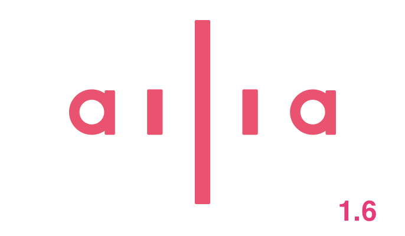
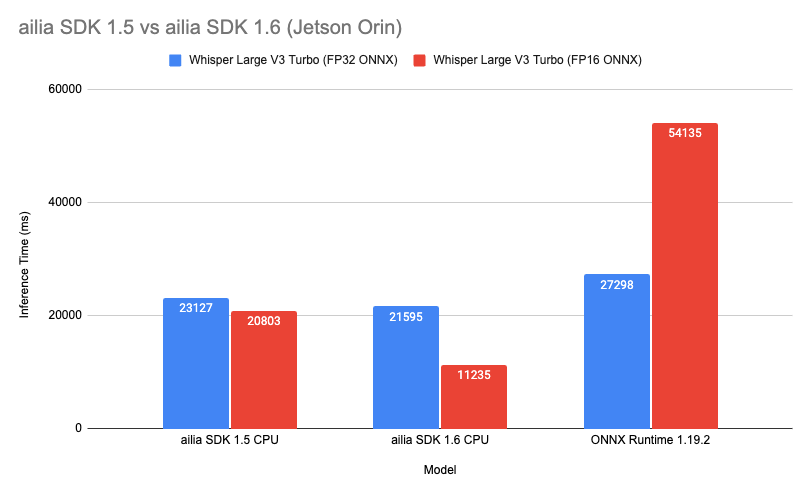
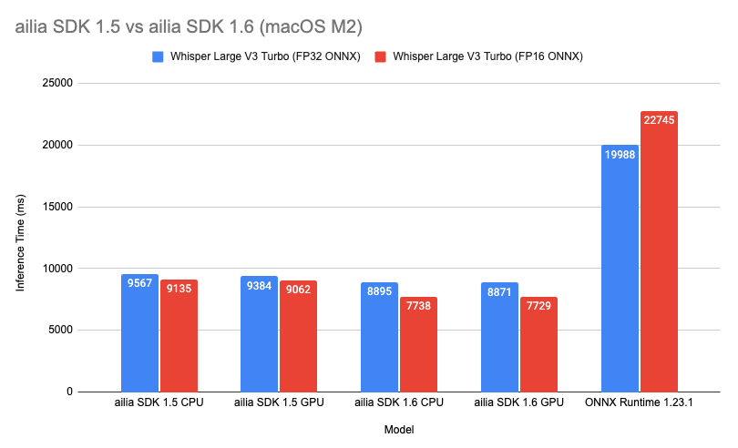
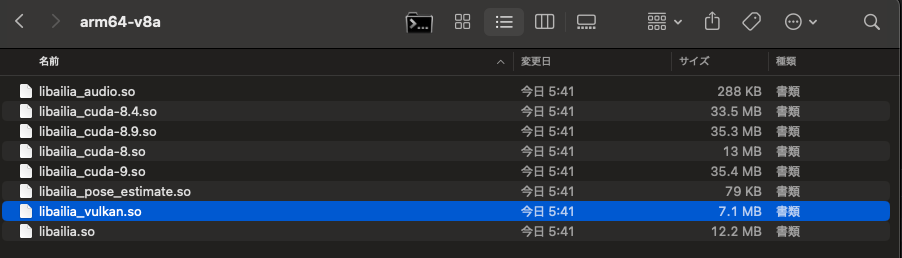

# Released ailia SDK 1.6.0

[Ailia Sdk](/tag/ailia-sdk?source=post_page---header_tags--034f8092bf7f-----------------------------------------)

# Released ailia SDK 1.6.0

[](/@kyakuno?source=post_page---byline--034f8092bf7f-----------------------------------------)

[Kazuki Kyakuno](/@kyakuno?source=post_page---byline--034f8092bf7f-----------------------------------------)

4 min read

·

Just now

--

[Listen](/m/signin?actionUrl=https%3A%2F%2Fmedium.com%2Fplans%3Fdimension%3Dpost_audio_button%26postId%3D034f8092bf7f&operation=register&redirect=https%3A%2F%2Fmedium.com%2Faxinc-ai%2Freleased-ailia-sdk-1-6-0-034f8092bf7f&source=---header_actions--034f8092bf7f---------------------post_audio_button--------------------)

Share

We have released ailia SDK 1.6, which adds support for Arm v8.2 NEON-FP16 instructions and Vulkan support on Linux Arm64.

---



## New Features

### Acceleration with Arm v8.2 FP16 instructions

We have added support for Arm v8.2 FP16 instructions in CPU inference.  
In the conventional implementation, FP16 weights were converted to FP32, and computation was performed using FP32 NEON-FP32. In ailia SDK 1.6, inference is faster than before by using NEON-FP16 instructions and performing computation in FP16 as-is. The NEON-FP32 register width is 128 bits, and SIMD operations are performed in parallel on 4 elements for FP32, while NEON-FP16 enables SIMD operations in parallel on 8 elements.  
This is a comparison of inference speed on the Arm Cortex-A78AE (12 cores) of Jetson AGX Orin. Using Whisper Large V3 Turbo, we evaluated the time required to perform speech recognition on 11 seconds of audio on the CPU. By using an FP16 ONNX model and Arm NEON-FP16 instructions, inference is possible at 1.85 times the previous speed.

Press enter or click to view image in full size



This is a comparison on an M2 Mac. The M2 includes Apple’s proprietary matrix multiplication engine, AMX, which is used via the Accelerate Framework. Since the Accelerate Framework supports only FP32, there is a conversion cost from FP16 to FP32, so the speedup is not as significant as on Jetson. However, because layers other than Gemm are accelerated with NEON-FP16, inference is possible at 1.15 times the previous speed overall.

Press enter or click to view image in full size



To try it yourself, add the — fp16 option to Whisper in ailia-models. With this option, an FP16 ONNX model can be used.

```
python3 whisper.py -b -m turbo   
python3 whisper.py -b -m turbo --fp16
```

[## ailia-models/audio\_processing/whisper at master · axinc-ai/ailia-models

### The collection of pre-trained, state-of-the-art AI models for ailia SDK — ailia-models/audio\_processing/whisper at…

github.com](https://github.com/axinc-ai/ailia-models/tree/master/audio_processing/whisper?source=post_page-----034f8092bf7f-----------------------------------------)

To convert a local FP32 ONNX model to an FP16 model, use onnx\_converter\_common. By setting keep\_io\_types=True, the inputs and outputs remain FP32 while only the internal tensors and weights can be converted to FP16.

```
import onnx  
from onnxconverter_common.float16 import convert_float_to_float16  
model = onnx.load("encoder_turbo.onnx")  
model_fp16 = convert_float_to_float16(model, disable_shape_infer=True, keep_io_types=True)  
onnx.save(model_fp16, "encoder_turbo_fp16.onnx")
```

[## Float16 and mixed precision models

### ONNX Runtime: cross-platform, high performance ML inferencing and training accelerator

onnxruntime.ai](https://onnxruntime.ai/docs/performance/model-optimizations/float16.html?source=post_page-----034f8092bf7f-----------------------------------------)

### Linux Arm64 Vulkan support

Vulkan can now be used on Linux Arm64 as well. GPU inference with Vulkan is now supported in a wider range of environments than before.

Press enter or click to view image in full size



Added libailia\_vulkan.so to the Linux/Arm64 package

### Support for new layers

Support has been added for Multinomial, Blackman Window, Hann Window, Hamming Window, MelWeightMatrix, and Shrink.

## Optimizations

### CPU / GPU speedups

We have improved CPU / GPU performance for various layers. We also improved Vulkan dynamic shape performance.

### Reduced memory usage

For FP16 ONNX models, weights are now kept in FP16. This can reduce memory usage.

### Attention speedup

Flash Attention has been introduced for CUDA and Vulkan, improving speed.

## Platform support

### Support for Google Pixel 10

We have added support and optimizations for Google Pixel 10. We have also fixed an issue where expectation errors occurred in Vulkan due to PowerVR-specific behavior on the Imagination Technologies PowerVR used in Pixel 10. In addition, when the Arm SVE vector length is the same as NEON, we have optimized it so that NEON is called instead of SVE.

### Support for Android 16KB page size

To meet Android store requirements, support for 16KB page size has been added.

### Support for Raspberry Pi 5

Raspberry Pi 5 is now supported in the Arm64 evaluation binary. We have fixed an issue in the ailia SDK 1.5 evaluation version where it could not run in 64-bit mode on Raspberry Pi 5 because of its small page size.

## Download

ailia SDK 1.6 can be downloaded from the page below. For Python, it can also be installed with pip3 install ailia.

[## ailia Trial form | ailia

### Application form for ailia SDK evaluation licenses.

ailia.ai](https://ailia.ai/en/trial/?source=post_page-----034f8092bf7f-----------------------------------------)

---

As a company that puts AI into practical use, [ailia Inc.](https://ailia.ai/en/) develops the ailia SDK, which enables fast GPU-based inference across platforms. ailia Inc. provides total AI solutions related to AI, including consulting, model creation, SDK provision, AI-based application and system development, and support, so please feel free to [contact us](https://ailia.ai/en/).