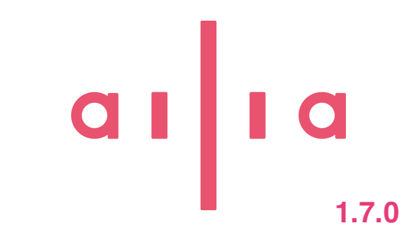

# Released ailia SDK 1.7.0

[Ailia Sdk](/tag/ailia-sdk?source=post_page---header_tags--6b2e7b0c373b-----------------------------------------)

# Released ailia SDK 1.7.0

[](/@kyakuno?source=post_page---byline--6b2e7b0c373b-----------------------------------------)

[Kazuki Kyakuno](/@kyakuno?source=post_page---byline--6b2e7b0c373b-----------------------------------------)

5 min read

·

Just now

--

[Listen](/m/signin?actionUrl=https%3A%2F%2Fmedium.com%2Fplans%3Fdimension%3Dpost_audio_button%26postId%3D6b2e7b0c373b&operation=register&redirect=https%3A%2F%2Fmedium.com%2Faxinc-ai%2Freleased-ailia-sdk-1-7-0-6b2e7b0c373b&source=---header_actions--6b2e7b0c373b---------------------post_audio_button--------------------)

Share

We have released ailia SDK 1.7, which supports MatMulNBits, GRU, and CUDA 13.

---



## New Features

### Support for MatMulNBits

By adding support for MatMulNBits, we now support inference with models whose weights are quantized to 4 bits. This makes it possible to reduce VRAM usage in models such as Qwen2VL. It also enables fast computation using int8 GEMM by expanding 4-bit Block Float weights to 8-bit.

```
python3 qwen2_vl.py -b --quantize int4
```

### Support for GRU

We have added support for GRU used in audio processing. This enables DeepFilterV3 to run. High-quality audio noise reduction can be performed.

```
python3 ailia_voice_filter.py -m deepfilternet
```

[## ailia-models/audio\_processing/ailia\_voice\_filter at master · ailia-ai/ailia-models

### The collection of pre-trained, state-of-the-art AI models for ailia SDK …

github.com](https://github.com/ailia-ai/ailia-models/tree/master/audio_processing/ailia_voice_filter?source=post_page-----6b2e7b0c373b-----------------------------------------)

### Expanded support for existing layers

Support for opset 27 has been added. We also expanded support parameters for QuantizeLinear / DequantizeLinear / ScatterElements / ScatterND / Pad / LayerNormalization / Attention / Swish.

### FP16 data type support for CUDA and Vulkan

We expanded CUDA and Vulkan data type support and added support for FP32/FP16 type propagation in mixed FP16/FP32 models.

## Performance improvements

### CPU implementation

We added a fuser and SIMD implementation for MultiScaleDeformableAttention. We also improved the SIMD implementation of Activation and LogSoftmax.

We improved MatMul with a single element in 3D.

We added FP16 support for Cos, Exp, Log, Sin, Sqrt, Reduce-related operations, Pad, ConstantOfShape, Where, and Pooling.

### New GPU implementations

We added GPU implementations for GridSample, GroupNormalization, Tile, Round, Floor, Ceil, TopK, And, Not, Tan, and Atan.

To speed up SAM 3.1, we added GPU support for Einsum.

To speed up Qwen3 TTS, we added MPS and Vulkan support for Deconvolution1D.

### Expanded GPU implementation

To speed up Qwen2VL, we added support for the scale input of RMSNormalization. We also added DNN support for Gather with 5 or more dimensions and FP16 Gather. We added alpha support for Swish.

### CUDA implementation speedups

We improved the performance of Convolution, Deconvolution, Attention, Reduce, LayerNormalization, Concat, Gather, Transpose, Resize, and Eltwise.

We introduced algorithm search for Gemm/Matmul.

When temporaryCachePath is specified, the results of Convolution algorithm search are cached to disk, speeding up the next load.

We accelerated internal NCHW/NHWC conversion in CUDA.

### Vulkan implementation speedups

We improved GEMM, Reduce, InstanceNormalization, Convolution, Deconvolution, Attention, and GridSample.

We also improved shader compilation and resource management.

### MPS implementation speedups

We improved MPS Attention.

### Faster loading of encrypted models

We accelerated loading of encrypted models in environments where AES instructions cannot be used.

### Platform support

### CUDA 13 support

We added support for CUDA 13 + cuDNN 9. We also changed the CUDA module file naming format to “ailia\_cuda-(cuDNN version)-(CUDA major version)”.

[## CUDA Toolkit / cuDNN Installation Guide - ailia SDK

### Step-by-step guide to install CUDA Toolkit and cuDNN on Windows and Linux for GPU-accelerated inference with ailia SDK.

docs.ailia.ai](https://docs.ailia.ai/en/setup/cuda/?source=post_page-----6b2e7b0c373b-----------------------------------------)

### Support for Arm Windows

We added support for Arm Windows in the Python package. We also started providing Vulkan binaries for Arm Windows.

[## Windows on Arm Setup Guide - ailia SDK

### How to set up Python, OpenCV, numpy, and ailia SDK on Windows on Arm (WoA).

docs.ailia.ai](https://docs.ailia.ai/en/setup/woa/?source=post_page-----6b2e7b0c373b-----------------------------------------)

### Enabling CooperativeMatrix on Arm Mali

We now support fast matrix multiplication using CooperativeMatrix on Arm Mali.

### Support for Jetson Thor and DGX Spark

We added support for Jetson Thor and DGX Spark.

### Support for iOS simulator

We added binaries for the iOS simulator.

### ailia.js

We added SIMD support and multi-threading support to ailia.js. Since ailia.js can handle encrypted models, it makes it possible to provide browser demos while protecting AI models. It is actually used in the demos below.

[## Glasses Virtual Try-On | ailia

### Try on glasses in your browser with the ailia on-device virtual try-on model. No image leaves your device.

ailia.ai](https://ailia.ai/en/vto/demo/?source=post_page-----6b2e7b0c373b-----------------------------------------)

[## Voice Noise Reduction Demo | ailia

### Try voice noise reduction right in your browser. Switch between our own ailia Voice Filter and the open-source…

ailia.ai](https://ailia.ai/en/voicefilter/demo/?source=post_page-----6b2e7b0c373b-----------------------------------------)

[## Age & Gender Estimation Demo | ailia

### Estimate age and gender in your browser with the ailia on-device model optimized for Japanese faces. Works with masks…

ailia.ai](https://ailia.ai/en/demographics/demo/?source=post_page-----6b2e7b0c373b-----------------------------------------)

## Toolchain

### Improvements to the toolchain for macOS

We made the macOS model encryption tool a universal binary and added digital signing.

### Improvements to onnx2prototxt

We changed it so that metadata\_props output by newer versions of Torch are not written to prototxt.

## Experimental features

### Support for CUDA Graph

When a graph has many nodes and the same graph is executed repeatedly, such as a Transformer decoder, kernel invocation overhead becomes significant.

In ailia SDK 1.7, CUDA Graph can now be enabled by setting the environment variable AILIA\_ENABLE\_DNN\_SEGMENT=1.  
CUDA Graph is a mechanism that reduces CUDA kernel invocation overhead by capturing and executing a CUDA execution graph. This is equivalent to enable\_cuda\_graph in ONNX Runtime.

This can provide roughly a 2x speedup when there are many nodes, such as in Qwen3 TTS. On an RTX 3080 with cuDNN, RTF improved from 1.105 to 0.398, enabling real-time speech synthesis.

When using CUDA Graph, memory reuse mode must be disabled. It cannot be used with dynamic graphs and is only available for static graphs.  
In ailia SDK 1.7, this is introduced as an experimental feature, but it is scheduled to be officially introduced in ailia SDK 1.8.

### Vulkan DNN\_SEGMENT support

On Vulkan, we also implement CUDA-Graph-like behavior using command buffer reuse. As with CUDA Graph, using AILIA\_ENABLE\_DNN\_SEGMENT=1 speeds up Qwen3 TTS on RTX 3080 Vulkan from RTF 0.913 to 0.694. This enables real-time speech synthesis in Vulkan environments as well.

### Sample for Qwen3 TTS Streaming

Qwen3 TTS Streaming can be run with the sample below. The play option plays audio in real time through the speaker. The script enables DNN\_SEGMENT via an environment variable internally.

```
python3 qwen3-tts-streaming.py --play
```

[## ailia-models/audio\_processing/qwen3-tts-streaming at master · ailia-ai/ailia-models

### The collection of pre-trained, state-of-the-art AI models for ailia SDK …

github.com](https://github.com/ailia-ai/ailia-models/tree/master/audio_processing/qwen3-tts-streaming?source=post_page-----6b2e7b0c373b-----------------------------------------)

## Try ailia SDK

For how to use ailia SDK, please refer to the documentation site below.

[## ailia Documentation

### ailia SDK - Cross-platform inference engine with ONNX GPU inference using Metal and Vulkan. 400+ models…

docs.ailia.ai](https://docs.ailia.ai/en/?source=post_page-----6b2e7b0c373b-----------------------------------------)

---

As a company that puts AI into practical use, [ailia Inc.](https://ailia.ai/en/) develops the ailia SDK, which enables fast GPU-based inference across platforms. ailia Inc. provides total AI solutions related to AI, including consulting, model creation, SDK provision, AI-based application and system development, and support, so please feel free to [contact us](https://ailia.ai/en/).