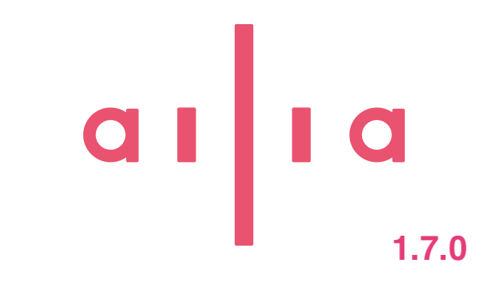

# ailia SDK 1.7をリリース

[Ailia Sdk](/tag/ailia-sdk?source=post_page---header_tags--d17df3365b71-----------------------------------------)

# ailia SDK 1.7をリリース

[](/@kyakuno?source=post_page---byline--d17df3365b71-----------------------------------------)

[Kazuki Kyakuno](/@kyakuno?source=post_page---byline--d17df3365b71-----------------------------------------)

9 min read

·

Just now

--

Share

MatMulNBits、GRU、CUDA13に対応したailia SDK 1.7をリリースしました。

---



## 機能追加

### MatMulNBits対応

MatMulNBitsに対応することで、ウェイトを4bitに量子化したモデルの推論に対応しました。これにより、Qwen2VLなどでVRAMの使用量を抑制することが可能です。また、Block Floatの4bitのウェイトを8bitに展開してint8 GEMMを使用した高速演算が可能になります。

```
python3 qwen2_vl.py -b --quantize int4
```

[## MatMulNBits : LLM/VLMをONNXで動かすための4bit量子化

### MatMulNBitsを使用することで、ONNXでも4bit量子化を実現し、LLM/VLMを少ないVRAMで動作させることが可能になります。

medium.com](/axinc/matmulnbits-llm-vlm%E3%82%92onnx%E3%81%A7%E5%8B%95%E3%81%8B%E3%81%99%E3%81%9F%E3%82%81%E3%81%AE4bit%E9%87%8F%E5%AD%90%E5%8C%96-6cb572b43c19?source=post_page-----d17df3365b71-----------------------------------------)

### GRU対応

音声で使用するGRUに対応しました。DeepFilterV3が動作するようになります。高品質な音声ノイズ除去を実行可能です。

```
python3 ailia_voice_filter.py -m deepfilternet
```

[## ailia-models/audio\_processing/ailia\_voice\_filter at master · ailia-ai/ailia-models

### The collection of pre-trained, state-of-the-art AI models for ailia SDK …

github.com](https://github.com/ailia-ai/ailia-models/tree/master/audio_processing/ailia_voice_filter?source=post_page-----d17df3365b71-----------------------------------------)

### 既存レイヤーの対応拡張

opset 27に対応しました。QuantizeLinear / DequantizeLinear / ScatterElements / ScatterND / Pad / LayerNormalization / Attention / Swishの対応パラメータの拡張を行いました。

### CUDAとVulkanのFP16のデータ型対応

CUDAとVulkanのデータ型対応を拡張し、FP16 / FP32混在モデルにおけるFP32とFP16の型伝搬に対応しました。

## 高速化

### CPU実装

MultiScaleDeformableAttentionのFuserとSIMD実装を追加しました。Activation、LogSoftmaxのSIMD実装の高速化を行いました。

3次元で要素数1のMatMulの高速化を行いました。

Cos、Exp、Log、Sin、Sqrt、Reduce系、Pad、ConstantOfShape、Where、PoolingのFP16対応を行いました。

### GPU実装の新規追加

GridSample、GroupNormalization、Tile、Round、Floor、Ceil、TopK、And、Not、Tan、AtanのGPU実装を追加しました。

SAM 3.1の高速化を目的として、EinsumのGPU対応を行いました。

Qwen3 TTSの高速化を目的として、Deconvolution1DのMPS、Vulkan対応を行いました。

### GPU実装の拡張

Qwen2VLの高速化を目的として、RMSNormalizationのscale入力対応を行いました。5次元以上のGather、FP16のGatherのDNN対応を行いました。Swishのalpha対応を行いました。

### CUDA実装の高速化

Convolution、Deconvolution、Attention、Reduce、LayerNormalization、Concat、Gather、Transpose、Resize、Eltwiseの高速化を行いました。

Gemm/Matmulにアルゴリズム探索を導入しました。

temporaryCachePathが指定されている場合にConvolutionのアルゴリズム探索結果をディスクにキャッシュすることで、次回の読み込みを高速化しました。

CUDA内部のNCHW/NHWC変換を高速化しました。

### Vulkan実装の高速化

GEMM、Reduce、InstanceNormalization、Convolution、Deconvolution、Attention、GridSampleの高速化を行いました。

シェーダのコンパイルやリソース管理を改善しました。

### MPS実装の高速化

MPSのAttentionの高速化を行いました。

### 暗号化モデルの読み込みの高速化

AES命令を使用できない環境での暗号化モデルの読み込みを高速化しました。

### プラットフォームサポート

### CUDA13対応

CUDA13 + cuDNN 9に対応しました。合わせて、CUDAモジュールのファイル名を「ailia\_cuda-(cuDNNバージョン)-(CUDAメジャーバージョン)」の形式に変更しています。

[## CUDA Toolkit / cuDNN インストールガイド - ailia SDK

### Windows / Linux に CUDA Toolkit と cuDNN を導入し、ailia SDK で NVIDIA GPU を使った高速推論を行うための手順を解説します。

docs.ailia.ai](https://docs.ailia.ai/setup/cuda/?source=post_page-----d17df3365b71-----------------------------------------)

### Arm Windows対応

PythonパッケージでArm Windowsに対応しました。また、Arm Windows向けのVulkanバイナリの提供を開始しました。

[## Windows on Arm セットアップガイド - ailia SDK

### Windows on Arm (WoA) 環境で Python、OpenCV、numpy、ailia SDK をセットアップする手順を解説します。

docs.ailia.ai](https://docs.ailia.ai/setup/woa/?source=post_page-----d17df3365b71-----------------------------------------)

### Arm MaliのCooperativeMatrixの有効化

Arm MaliでCooperativeMatrixを使用した高速な行列積に対応しました。

### Jetson ThorとDGX Spark対応

Jetson ThorとDGX Sparkへの対応を行いました。

### iOSシミュレータ対応

iOSシミュレータのバイナリを追加しました。

### ailia.js

ailia.jsのSIMD対応およびマルチスレッド対応を行いました。ailia.jsは暗号化モデルを扱うことができるため、AIモデルを保護しつつ、ブラウザでのデモを提供可能になります。実際に下記のデモで使用しています。

[## メガネ試着デモ | アイリア

### ブラウザでメガネを試着できる、アイリアのオンデバイス バーチャル試着デモ。

ailia.ai](https://ailia.ai/vto/demo/?source=post_page-----d17df3365b71-----------------------------------------)

[## 音声ノイズ除去デモ｜アイリア

### 音声ノイズ除去をブラウザで体験。当社独自の アイリア Voice Filter と OSS の DeepFilterNet3 を切り替えて、マイクや音声ファイルの雑音を除去できます。音声は端末の外に送信されません。

ailia.ai](https://ailia.ai/voicefilter/demo/?source=post_page-----d17df3365b71-----------------------------------------)

[## 年齢・性別推定デモ｜アイリア

### 日本人の顔に最適化した年齢・性別推定モデルをブラウザで体験できます。

ailia.ai](https://ailia.ai/demographics/demo/?source=post_page-----d17df3365b71-----------------------------------------)

## ツールチェイン

### macOS向けのツールチェインの改良

macOS向けのモデル暗号化ツールをユニバーサルバイナリとし、電子署名を付与するようにしました。

### onnx2prototxtの改良

新しいTorchの出力するmetadata\_propsをprototxtに出力しないようにしました。

## 試験的機能

### CUDA Graph対応

TransformerのDecoderなど、ノード数が多く、同じグラフを繰り返し実行する場合、カーネルの呼び出しコストが大きくなります。

ailia SDK 1.7では環境変数でAILIA\_ENABLE\_DNN\_SEGMENT=1とすることでCUDA Graphを有効にすることができるようになりました。

CUDA Graphは、CUDAの実行グラフをキャプチャーし、実行することで、CUDAのカーネル呼び出しコストを削減する仕組みです。ONNX Runtimeにおけるenable\_cuda\_graphに相当します。

これにより、Qwen3 TTSなど、ノード数が多く存在する場合に2倍程度の高速化効果が得られ、RTX3080のcuDNNのRTFが1.105から0.398まで高速化し、リアルタイムで音声合成が可能です。

CUDA Graphを使用する場合、メモリ再利用モードは無効にする必要があります。また、動的グラフでは使用できず、静的グラフにのみ使用可能です。

ailia SDK 1.7では試験的機能としての導入となりますが、ailia SDK 1.8で正式に導入される予定です。

### VulkanのDNN\_SEGMENT対応

Vulkanでもコマンドバッファの再利用を使用してCUDA Graph相当の実装を行なっています。CUDA Graphと同様にAILIA\_ENABLE\_DNN\_SEGMENT=1を使用することで、Qwen3 TTSでRTX3080のVulkanのRTFが0.913から0.694まで高速化します。Vulkan環境でもリアルタイムの音声合成を実現します。

### Qwen3 TTS Streamingのサンプル

Qwen3 TTS Streamingは下記のサンプルで実行可能です。playオプションでスピーカーにリアルタイム再生します。スクリプトの中で環境変数でDNN\_SEGMENTを有効にしています。

```
python3 qwen3-tts-streaming.py --play
```

[## ailia-models/audio\_processing/qwen3-tts-streaming at master · ailia-ai/ailia-models

### The collection of pre-trained, state-of-the-art AI models for ailia SDK …

github.com](https://github.com/ailia-ai/ailia-models/tree/master/audio_processing/qwen3-tts-streaming?source=post_page-----d17df3365b71-----------------------------------------)

## ailia SDKを使ってみる

ailia SDKの使用方法は、下記のドキュメントサイトを参照ください。

[## ailia ドキュメント

### ailia SDK - Metal と Vulkan を使った ONNX GPU 推論をサポートするクロスプラットフォーム推論エンジン。400 種以上のモデルと Python / C++ / C# / Flutter…

docs.ailia.ai](https://docs.ailia.ai/?source=post_page-----d17df3365b71-----------------------------------------)

---

アイリア株式会社はAIを実用化する会社として、クロスプラットフォームでGPUを使用した高速な推論を行うことができるailia SDKを開発しています。アイリア株式会社ではコンサルティングからモデル作成、SDKの提供、AIを利用したアプリ・システム開発、サポートまで、 AIに関するトータルソリューションを提供していますのでお気軽に[お問い合わせ](https://ailia.ai/contact/)ください。