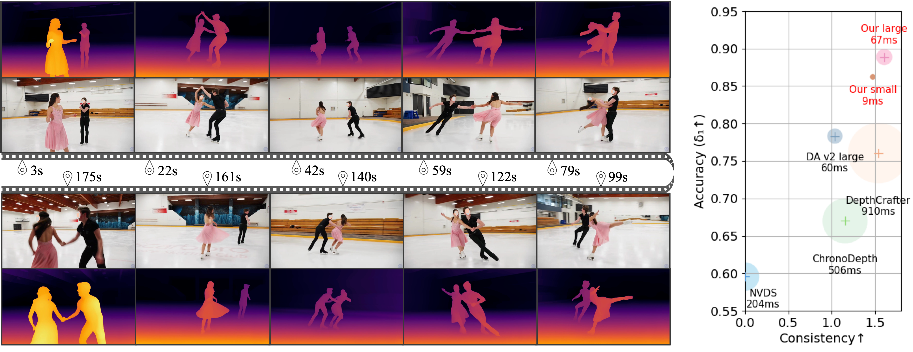
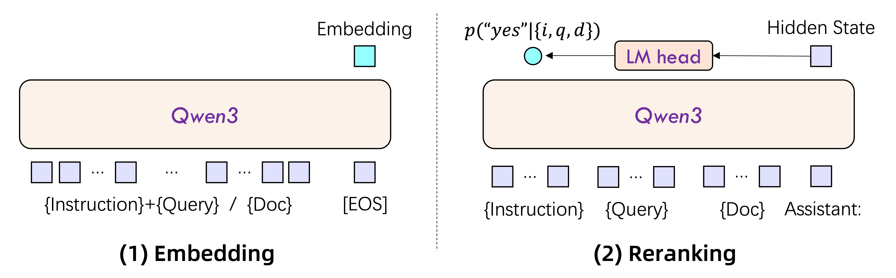
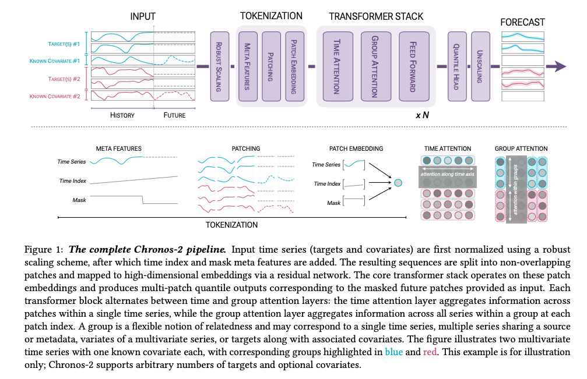

# 2025年に公開されたエッジAIモデル

[Ailia Models](/tag/ailia-models?source=post_page---header_tags--773f93ef0519------------------------------------------)

# 2025年に公開されたエッジAIモデル

[Kazuki Kyakuno](/@kyakuno?source=post_page---byline--773f93ef0519------------------------------------------)

6 min read

·

Just now

--

Share

2025年に公開された各分野のエッジAIモデルを紹介します。ウエイトが公開されており、クラウド接続不要で使用可能です。

---

## Video Depth Anything

Byte Danceが2025年1月に公開した深度推定モデルです。Depth Anything v2はDINOv2バックボーンを使用することで高精度な深度推定が可能ですが、フレーム間で深度が変動するという問題がありました。Video Depth Anythingは画面内のGradient Matching Lossだけでなく、画面間のTemporal Gradient Matching Lossを導入することで、フレーム間で一貫した深度を推定します。

Press enter or click to view image in full size

出典：<https://github.com/DepthAnything/Video-Depth-Anything>

[## GitHub - DepthAnything/Video-Depth-Anything: [CVPR 2025 Highlight] Video Depth Anything: Consistent…

### CVPR 2025 Highlight] Video Depth Anything: Consistent Depth Estimation for Super-Long Videos …

github.com](https://github.com/DepthAnything/Video-Depth-Anything?source=post_page-----773f93ef0519------------------------------------------)

SmallモデルはApacheライセンス、BaseとLargeモデルはCC-BY-NC-4.0です。Smallモデルはモデルサイズが118.5MBですが、32フレームまとめて深度推定するため、演算量は大きいです。相対深度モデルと、絶対深度のMetric Depthモデルの2種類が公開されています。

[## ailia-models/depth\_estimation/video\_depth\_anything at master · ailia-ai/ailia-models

### The collection of pre-trained, state-of-the-art AI models for ailia SDK …

github.com](https://github.com/ailia-ai/ailia-models/tree/master/depth_estimation/video_depth_anything?source=post_page-----773f93ef0519------------------------------------------)

## Qwen3 Reranker

Alibabaが2025年1月に公開したリランキングモデルです。RAGの結果を並べ替えるのに使用します。従来、RerankerはSentence TransformerのようなCross Encoderを使用することが多かったですが、Qwen3 RerankerはLLMを使用して、出力される単語がYesかNoかの確率を計算することで関連度スコアを計算します。この構造は、Jevのような判断モデルに近いです。

Press enter or click to view image in full size

出典：<https://arxiv.org/html/2506.05176v1>

[## Qwen/Qwen3-Reranker-0.6B · Hugging Face

### Text Ranking model with 0.6B parameters. Download, explore files and run it on Hugging Face.

huggingface.co](https://huggingface.co/Qwen/Qwen3-Reranker-0.6B?source=post_page-----773f93ef0519------------------------------------------)

[## ailia-models/natural\_language\_processing/qwen3-reranker at master · ailia-ai/ailia-models

### The collection of pre-trained, state-of-the-art AI models for ailia SDK …

github.com](https://github.com/ailia-ai/ailia-models/tree/master/natural_language_processing/qwen3-reranker?source=post_page-----773f93ef0519------------------------------------------)

## Chronos2

Amazonが2025年10月に公開した時系列予測モデルです。未来共変量を使用した予測に対応しています。例えば、過去の天候とコンビニの売り上げを元に、未来の天候を入れて、コンビニの売り上げを予測することに使用可能です。Moiraiは商業利用が難しいライセンスですが、Chronos2はApache2で使いやすいです。

Press enter or click to view image in full size

出典：<https://arxiv.org/pdf/2510.15821>

[## amazon/chronos-2 · Hugging Face

### Time Series Forecasting model with 0.1B parameters. Download, explore files and run it on Hugging Face.

huggingface.co](https://huggingface.co/amazon/chronos-2?source=post_page-----773f93ef0519------------------------------------------)

[## ailia-models/time\_series\_forecasting/chronos2 at master · ailia-ai/ailia-models

### The collection of pre-trained, state-of-the-art AI models for ailia SDK - ailia-models/time\_series\_forecasting/chronos2…

github.com](https://github.com/ailia-ai/ailia-models/tree/master/time_series_forecasting/chronos2?source=post_page-----773f93ef0519------------------------------------------)

## GPT-SoVITS v2 Pro

2025年6月に公開された音声合成モデルです。v2という名前ですが、v3の後に公開されたモデルで、v3の音質と、v2の速度を両立させたモデルになっています。比較的、高速にゼロショットの音声合成が可能であるため、エッジデバイスで音声合成するのに向いています。

[## GitHub - RVC-Boss/GPT-SoVITS at 20250606v2pro

### 1 min voice data can also be used to train a good TTS model! (few shot voice cloning) - GitHub - RVC-Boss/GPT-SoVITS at…

github.com](https://github.com/RVC-Boss/GPT-SoVITS/tree/20250606v2pro?source=post_page-----773f93ef0519------------------------------------------)

[## ailia-models/audio\_processing/gpt-sovits-v2-pro at master · ailia-ai/ailia-models

### The collection of pre-trained, state-of-the-art AI models for ailia SDK …

github.com](https://github.com/ailia-ai/ailia-models/tree/master/audio_processing/gpt-sovits-v2-pro?source=post_page-----773f93ef0519------------------------------------------)

---

アイリア株式会社はAIを実用化する会社として、クロスプラットフォームでGPUを使用した高速な推論を行うことができるailia SDKを開発しています。アイリア株式会社ではコンサルティングからモデル作成、SDKの提供、AIを利用したアプリ・システム開発、サポートまで、 AIに関するトータルソリューションを提供していますのでお気軽に[お問い合わせ](https://ailia.ai/contact/)ください。