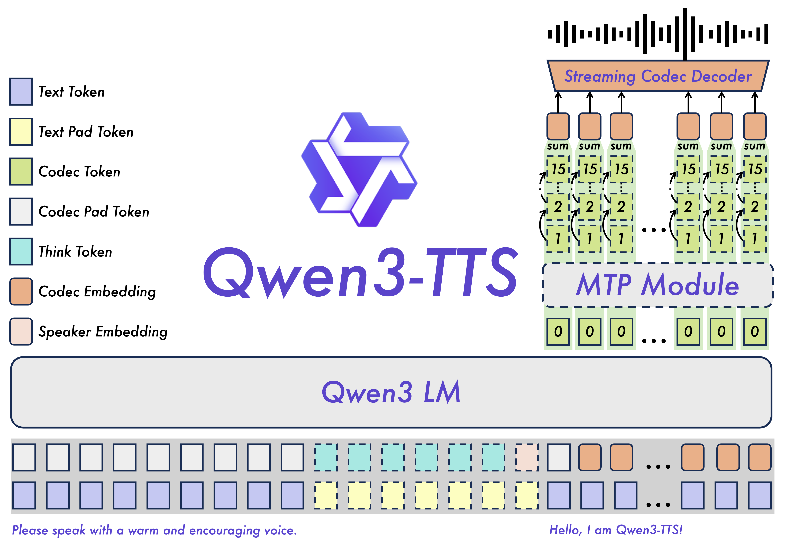
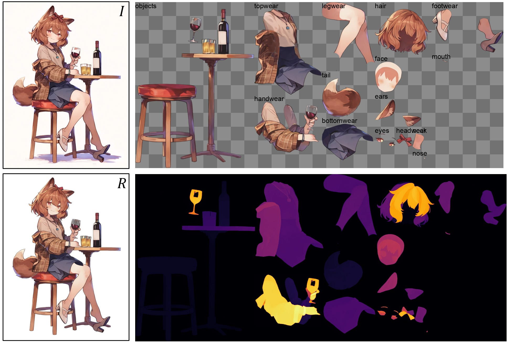
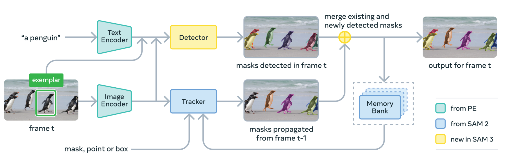

# 2026年に公開されたエッジAIモデル

[Ailia Models](/tag/ailia-models?source=post_page---header_tags--6e139ae232e0------------------------------------------)

# 2026年に公開されたエッジAIモデル

[Kazuki Kyakuno](/@kyakuno?source=post_page---byline--6e139ae232e0------------------------------------------)

7 min read

·

Just now

--

Share

2026年に公開された各分野のエッジAIモデルを紹介します。ウエイトが公開されており、クラウド接続不要で使用可能です。

---

## Qwen3-TTS

Alibabaが2026年1月にリリースした音声合成モデルです。音声トークンによる大規模な音声合成モデルで、クラウドの音声合成APIに近い品質の音声合成が可能です。0ショットで本人らしい音声の音声合成も可能。文字列を直接トークン化するので、G2Pが不要で、多言語のテキストをそのまま扱うことが可能です。

Press enter or click to view image in full size

出典：<https://github.com/QwenLM/Qwen3-TTS>

[## GitHub - QwenLM/Qwen3-TTS: Qwen3-TTS is an open-source series of TTS models developed by the Qwen…

### Qwen3-TTS is an open-source series of TTS models developed by the Qwen team at Alibaba Cloud, supporting stable…

github.com](https://github.com/QwenLM/Qwen3-TTS?source=post_page-----6e139ae232e0------------------------------------------)

[ailia SDK 1.7](/axinc/ailia-sdk-1-7%E3%82%92%E3%83%AA%E3%83%AA%E3%83%BC%E3%82%B9-d17df3365b71)とRTX3080でcuDNNやVulkanを使用するとテキストストリーミングによるリアルタイム処理（RTF 0.398）が可能です。

[## ailia-models/audio\_processing/qwen3-tts-streaming at master · ailia-ai/ailia-models

### The collection of pre-trained, state-of-the-art AI models for ailia SDK …

github.com](https://github.com/ailia-ai/ailia-models/tree/master/audio_processing/qwen3-tts-streaming?source=post_page-----6e139ae232e0------------------------------------------)

## See Throught

ShitagakiLabが2026年2月にリリースした画像のレイヤー分けモデルです。1枚の画像から、レイヤー分けしたPSDファイルを出力可能です。Inpaintingまで行ってくれるので、そのまま2Dアバターに活用可能です。Marigoldによる深度推定と、StableDiffusionベースのパーツ分離モデルで構成されています。

Press enter or click to view image in full size

出典：<https://github.com/shitagaki-lab/see-through>

[## GitHub - shitagaki-lab/see-through: "Single-image Layer Decomposition for Anime Characters"…

### "Single-image Layer Decomposition for Anime Characters" (SIGGRAPH 2026 Conference Paper) - shitagaki-lab/see-through

github.com](https://github.com/shitagaki-lab/see-through?source=post_page-----6e139ae232e0------------------------------------------)

ailia SDK 1.7向けにONNX変換済みです。VRAMを多く使うモデルなため、Int8量子化しており、9.9GBのVRAMで動作します。

[## ailia-models/diffusion/see-through at master · ailia-ai/ailia-models

### The collection of pre-trained, state-of-the-art AI models for ailia SDK - ailia-models/diffusion/see-through at master…

github.com](https://github.com/ailia-ai/ailia-models/tree/master/diffusion/see-through?source=post_page-----6e139ae232e0------------------------------------------)

## Segment Anything 3.1

Metaが2026年3月にリリースしたセグメンテーションモデルです。Segment Anything 2はPointかBoxアノテーションしか使用できませんでしたが、Segment Anything 3ではついにテキストラベルが使用できるようになり、任意物体をセグメンテーションできるようになりました。さらに、3.1ではObject Multiplexによる高速化が行われ、16個のオブジェクトを多重化して推論するため、7倍高速な推論が可能になりました。

Press enter or click to view image in full size

出典：<https://github.com/facebookresearch/sam3>

[## GitHub - facebookresearch/sam3: The repository provides code for running inference and finetuning…

### The repository provides code for running inference and finetuning with the Meta Segment Anything Model 3 (SAM 3), links…

github.com](https://github.com/facebookresearch/sam3?source=post_page-----6e139ae232e0------------------------------------------)

[## ailia-models/image\_segmentation/segment-anything-3.1 at master · ailia-ai/ailia-models

### The collection of pre-trained, state-of-the-art AI models for ailia SDK …

github.com](https://github.com/ailia-ai/ailia-models/tree/master/image_segmentation/segment-anything-3.1?source=post_page-----6e139ae232e0------------------------------------------)

## Embedding Gemma 2

Googleが2026年10月にリリースした埋め込みモデルです。Embedding Gemmaは高精度なテキストの埋め込みベクトルが取得できて便利でしたが、Embedding Gemma 2では音声や画像の埋め込みベクトルが取得できるようになりました。CLIPやCLAPなどと同じことができるので、ベクトル検索はEmbedding Gemma 2に一本化できるようになりました。

Press enter or click to view image in full size

出典：<https://huggingface.co/google/embeddinggemma-2>

[## google/embeddinggemma-2 · Hugging Face

### Feature Extraction model with 0.7B parameters. Download, explore files and run it on Hugging Face.

huggingface.co](https://huggingface.co/google/embeddinggemma-2?source=post_page-----6e139ae232e0------------------------------------------)

[## ailia-models/natural\_language\_processing/embeddinggemma-2 at master · ailia-ai/ailia-models

### The collection of pre-trained, state-of-the-art AI models for ailia SDK …

github.com](https://github.com/ailia-ai/ailia-models/tree/master/natural_language_processing/embeddinggemma-2?source=post_page-----6e139ae232e0------------------------------------------)

特徴ベクトルの比較を使用して、Jevのような判断モデルとして使用する応用も進んでいます。

[## Decision Maker | Google AI Edge | Google for Developers

### 34;Score choices, boolean checks, and structured rubrics in a single on-device forward pass across Web, Android, iOS…

developers.google.com](https://developers.google.com/edge/mediapipe/solutions/decision/decision_maker?source=post_page-----6e139ae232e0------------------------------------------)

---

アイリア株式会社はAIを実用化する会社として、クロスプラットフォームでGPUを使用した高速な推論を行うことができるailia SDKを開発しています。アイリア株式会社ではコンサルティングからモデル作成、SDKの提供、AIを利用したアプリ・システム開発、サポートまで、 AIに関するトータルソリューションを提供していますのでお気軽に[お問い合わせ](https://ailia.ai/contact/)ください。